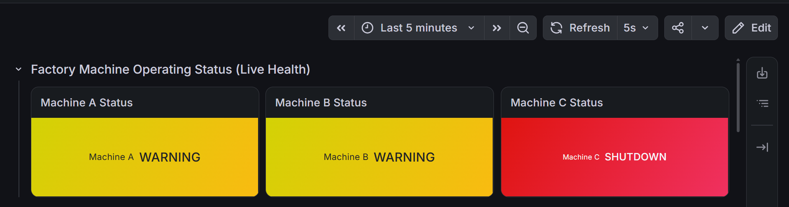
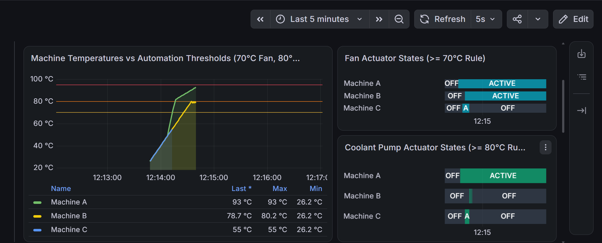
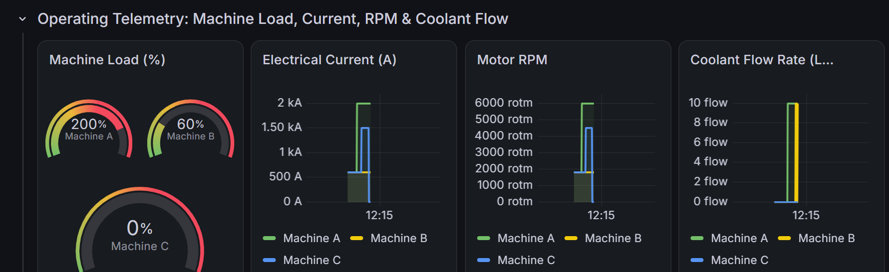
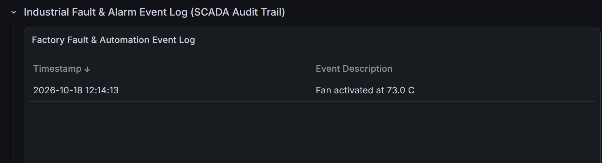

# Virtual Industrial IoT Monitoring & Automation Platform

[](https://en.wikipedia.org/wiki/C%2B%2B17)
[](https://cmake.org/)
[](https://mosquitto.org/)
[](https://www.influxdata.com/)
[](https://grafana.com/)
[]()
[]()

A robust, C++17 virtual industrial monitoring and rule-based automation platform designed to simulate multi-machine shop-floor operations. The platform simulates three virtual industrial production units (**Machine A**, **Machine B**, and **Machine C**) equipped with simulated sensors and cooling actuators. It features deterministic safety automation, edge-triggered fault and recovery lifecycle logging, thread-safe MQTT command routing with broadcast support, device health state separation, resilient InfluxDB time-series storage with write retry buffering, and a portable Grafana SCADA dashboard.

---

## Grafana Unified Factory Dashboard

The platform streams real-time telemetry into InfluxDB v2, visualized live through an 11-panel Grafana dashboard with `${datasource}` variable portability.

### 1. Live Machine Operating Health
Continuous assessment of all machines across the plant floor, displaying operational status based on temperature thresholds and hardware health.


### 2. Thermal Control & Automated Closed-Loop Cooling
Real-time temperature curves plotted directly against configurable safety limits (**70°C Fan**, **80°C Pump**, **95°C Emergency Shutdown**), alongside discrete state timelines for cooling actuators (0 = OFF, 1 = ACTIVE, 2 = FAILED).


### 3. Operating Telemetry: Electrical Load, Current, RPM & Coolant Flow
Live gauges and multi-line time series tracking electrical load setpoints (spiking to 200% under simulated overload), phase current (A), motor speed (RPM), and coolant flow rate (L/min).


### 4. Industrial Fault & Alarm Event Log (SCADA Audit Trail)
Chronological record of platform events, fault injections, safety trips, and actuator state transitions with color-coded severity badges (`CRITICAL`, `WARNING`, `INFO`).


---

## System Architecture

```
                       +-----------------------------+
                       |   Virtual Factory Engine    |
                       | (Machine A, B, C Physics)   |
                       +--------------+--------------+
                                      |
                 +--------------------+--------------------+
                 |                                         |
                 v                                         v
    +------------------------+                +-------------------------+
    |   Automation Engine    |                |  Device Health Monitor  |
    | (Dynamic 70°C Fan,     |                |  Separates Heartbeat,   |
    |  80°C Pump, 95°C Trip) |                |  Validity & Operational |
    +------------+-----------+                +------------+------------+
                 |                                         |
                 +--------------------+--------------------+
                                      |
                                      v
                         +-------------------------+
                         |   Telemetry Processor   |
                         |  & Validation Pipeline  |
                         +------------+------------+
                                      |
                      +---------------+---------------+
                      |                               |
                      v                               v
        +---------------------------+   +---------------------------+
        |   MQTT Broker (Mosquitto) |   |    InfluxDB v2 Storage    |
        |  Synchronized Command Q,  |   |  Buffered Line Protocol   |
        |  Broadcast & ACKs         |   |  Telemetry & Events Store |
        +-------------+-------------+   +-------------+-------------+
                      |                               |
                      +---------------+---------------+
                                      |
                                      v
                        +---------------------------+
                        |     Grafana Dashboard     |
                        | Status, Gauges, Flow,     |
                        | Actuators & Event History |
                        +---------------------------+
```

---

## Core Platform Capabilities

### 1. Multi-Machine Virtual Factory
Three independent virtual production units simulate thermodynamic and electromechanical behaviors:
* **Machine A** (`machine1`): High-load milling center
* **Machine B** (`machine2`): Precision CNC lathe
* **Machine C** (`machine3`): Heavy fabrication press

#### Dynamic Physics Engine:
* **Thermal Accumulation**: Heat generated proportional to electrical load: `+0.02 * load * dt`
* **Active Air Cooling**: When fan is running (`isFanRunning()`): `-1.0 °C/s`
* **Active Liquid Cooling**: When coolant pump is active (`isPumpRunning()`): `-2.5 °C/s`
* **Shutdown Cooldown**: When in shutdown: `-0.5 °C/s` down to ambient baseline ($25.0^\circ\text{C}$)
* **Electrical Load to Current**: `Current = Load * 10.0 A` (e.g. 60% load = 600 A; 200% overload = 2000 A)
* **Operational Spindle Speed**: `RPM = Load * 30.0 RPM` (e.g. 60% load = 1800 RPM; 200% overload = 6000 RPM)
* **Coolant Flow Rate**: `10.0 L/min` when pump is running; `0.0 L/min` when pump is OFF or failed

---

### 2. Standardized Telemetry Signals
Every machine emits 8 standardized telemetry signals on every 1-second simulation cycle:

| Signal | Measurement / Sensor | Engineering Unit | Valid Normal Range | Description |
| :--- | :--- | :--- | :--- | :--- |
| **`temperature`** | `temperature_sensor` | `°C` | $-40.0$ to $150.0$ | Core machine operational temperature |
| **`current`** | `current_sensor` | `A` | $0.0$ to $50000.0$ | Three-phase electrical draw |
| **`rpm`** | `rpm_sensor` | `RPM` | $0.0$ to $100000.0$ | Spindle / motor rotational velocity |
| **`load`** | `load_sensor` | `%` | $0.0$ to $1000.0$ | Electrical operating setpoint load |
| **`coolant_flow`** | `coolant_flow_sensor` | `L/min` | $0.0$ to $1000.0$ | Coolant circulation throughput |
| **`fan`** | `fan_status` | `state` | $0$ (OFF), $1$ (ACTIVE), $2$ (FAILED) | Air cooling actuator operational state |
| **`pump`** | `pump_status` | `state` | $0$ (OFF), $1$ (ACTIVE), $2$ (FAILED) | Liquid cooling actuator operational state |
| **`status`** | `machine_status` | `state` | $0$ (RUN), $1$ (WARN), $2$ (SHUTDOWN) | Overall machine health classification |

---

### 3. Actuator State Separation
To prevent masking mechanical failures, actuators maintain distinct operational dimensions:
1. **Commanded State**: Whether the automation engine or operator ordered the actuator ON (`isFanCommanded()`, `isPumpCommanded()`).
2. **Operational Health**: Whether the physical equipment is functional or experiencing hardware failure (`isFanOperational()`, `isPumpOperational()`).
3. **Running Condition**: True only if commanded ON, functional, and the machine is not shut down (`isFanRunning()`, `isPumpRunning()`).
4. **Cooling Effectiveness**: Direct heat extraction rate (`getFanCoolingRate()`, `getPumpCoolingRate()`).
5. **Telemetry State**: Explicitly serialized as `0 = OFF`, `1 = ACTIVE`, `2 = FAILED` across MQTT, InfluxDB, and Grafana.

---

### 4. Configurable Rule-Based Automation
Configured via `config/factory.json` and dynamically bound to `AutomationEngine`:

1. **Normal Operation ($< 70^\circ\text{C}$)**: Actuators remain OFF to conserve energy. Status: `RUNNING`.
2. **Air Cooling Trigger ($\ge 70^\circ\text{C}$)**: Fan turns ON automatically. Status: `WARNING`.
3. **Liquid Cooling Trigger ($\ge 80^\circ\text{C}$)**: Coolant pump engages (`Flow: 10.0 L/m`), running concurrently with the fan. Status: `WARNING`.
4. **Emergency Fail-Safe Shutdown ($\ge 95^\circ\text{C}$)**: Critical thermal runaway trip. Power and load cut to 0, actuators deactivated, and status set to `SHUTDOWN`.
5. **Fail-Safe Sensor Protection**: If a sensor failure occurs, fail-safe fan cooling engages to protect unmonitored hardware.
6. **Edge-Triggered Event Lifecycle**: Faults and recoveries are logged once on state transitions, preventing redundant log spam while preserving timestamps.

---

### 5. Safe Machine Recovery Rules
Clearing faults or resetting from an emergency shutdown enforces strict safety restrictions (`attemptRecovery()`):
* **Hot Restart Protection**: If machine core temperature is $\ge 80^\circ\text{C}$, recovery is rejected:
  ```text
  Recovery rejected: Core temperature 85 C is above safe threshold (80 C). Wait for cooldown.
  ```
* **Controlled Resumption**: Once cooled below $80^\circ\text{C}$, shutdown flags clear, faults reset, and load safely returns to baseline ($60.0\%$).

---

### 6. Simulated Fault Modes & Sentinel Marker
The platform models realistic industrial failure scenarios:

* **Electrical Overload (Machine A & C)**: Surge to 200% / 150% load, driving rapid thermal runaway ($+4.0^\circ\text{C/s}$).
* **Mechanical Fan Failure (Machine B)**: Fan motor seizes, reporting state `2` (FAILED) with quality `"bad"`.
* **Coolant Pump Motor Failure (Machine C)**: Pump motor failure zeroes coolant flow (`Flow: 0.0 L/m`), forcing Machine C toward thermal trip.
* **Sensor Hardware Failure (Machine C)**:
  * Emits the custom simulated sentinel value: **`-999.0°C`** (representing broken thermocouple / open-circuit probe).
  * `TelemetryProcessor::process()` marks quality as `"invalid"`.
  * InfluxDB stores points with `quality=invalid`.
  * Grafana queries filter `r._value >= 0.0 and r.quality == "good"`, preventing chart distortion while preserving fault audit history.

---

### 7. Device Health State Separation
The `DeviceHealthMonitor` independently evaluates three distinct dimensions for every device:
* **Communication Heartbeat (`online`)**: True if the device transmitted within the configured timeout (10 seconds).
* **Data Validity (`valid`)**: True if telemetry values are within calibrated physical limits and quality is valid.
* **Physical Condition (`operational`)**: True if hardware actuators and motors are intact without mechanical failure.

---

### 8. Edge-to-Cloud Integration

#### InfluxDB v2 Engine with Write Buffering
* **Batch Streaming**: InfluxDB Line Protocol over native Windows HTTP (WinHTTP).
* **Retry Buffer**: If network or InfluxDB drops, failed batches and events are buffered and automatically drained on subsequent cycles.
* **Target Settings**: Org: `athena`, Bucket: `industrial_iot`, URL: `http://localhost:8086`. Credentials loaded from `INFLUX_TOKEN`.

#### Thread-Safe MQTT Command & Broadcast Protocol
* **Thread-Safe Queue**: MQTT callback messages push to a synchronized `CommandQueue`, processed deterministically on the main simulation loop without data races.
* **Broadcast Routing**: Commands published to `factory/all/command` route across all registered machines and return structured aggregated acknowledgments on `factory/all/command/ack`.
* **Validation & Safety**: Validates command parameters (load 0-300%, fan ON/OFF, pump ON/OFF, fault types). Rejects invalid machine IDs and unsafe restarts.

---

## Project Repository Structure

```
virtual-industrial-iot/
├── .gitignore                      # Git ignore file for CMake, MSBuild, artifacts
├── CMakeLists.txt                  # Top-level CMake build configuration
├── README.md                       # Comprehensive project documentation
├── config/
│   └── factory.json                # Factory topology, MQTT & InfluxDB config
├── dashboards/
│   ├── industrial_factory_dashboard.json # Portable Grafana dashboard with ${datasource}
│   ├── factory_operating_status.png      # Machine status cards screenshot
│   ├── temperature_automated_cooling.png # Temperature & actuator timelines screenshot
│   ├── operating_telemetry.png           # Load, Current, RPM, Flow screenshot
│   └── scada_event_log.png               # SCADA audit trail table screenshot
├── docs/
│   ├── architecture.md             # Detailed engineering design document
│   ├── SETUP.md                    # Environment and toolchain setup guide
│   └── DEMO.md                     # Step-by-step evaluation guide
├── include/
│   ├── automation/AutomationEngine.h
│   ├── config/ConfigManager.h
│   ├── devices/                    # Sensor and Actuator interface definitions
│   ├── events/                     # Event & EventLogger definitions
│   ├── factory/                    # Machine & Factory domain models
│   ├── health/DeviceHealthMonitor.h
│   ├── mqtt/MQTTClient.h
│   ├── storage/InfluxWriter.h
│   └── telemetry/                  # Telemetry, Validator, & Processor
├── src/
│   ├── main.cpp                    # Factory loop, CommandQueue, simulation timeline
│   ├── automation/AutomationEngine.cpp
│   ├── config/ConfigManager.cpp
│   ├── devices/                    # Device implementation classes
│   ├── events/EventLogger.cpp
│   ├── factory/                    # Machine physics & state management
│   ├── health/DeviceHealthMonitor.cpp
│   ├── mqtt/MQTTClient.cpp
│   ├── storage/InfluxWriter.cpp
│   └── telemetry/                  # Telemetry validation & processing logic
└── tests/
    └── test_suite.cpp              # Automated test suite (Release-active assertions)
```

---

## Quick Start & Build Instructions

### Prerequisites
* **Windows 10/11 x64**
* **CMake 3.20+**
* **Visual Studio 2022 / C++ Build Tools** (MSVC C++17)
* **Eclipse Paho MQTT C++ Library** (via vcpkg or system)
* **InfluxDB v2.x** (listening on `localhost:8086`)
* **Mosquitto MQTT Broker** (listening on `localhost:1883`)
* **Grafana** (listening on `localhost:3000`)

### 1. Build the Platform
```powershell
# Generate CMake build files
cmake -B build

# Build Release binaries for platform and tests
cmake --build build --config Release
```

### 2. Run Automated Verification Tests
Tests use active assertions that remain enforced under Release mode (`NDEBUG` bypass proof):
```powershell
.\build\Release\industrial-iot-tests.exe
```
Output:
```text
======================================================
   Virtual Industrial IoT Automated Test Suite
   (Release-mode active assertion validation)
======================================================
[PASS] testAssertionIntegrity (Release-mode active verification)
[PASS] testTelemetryValidator
[PASS] testAutomationEngineRules
[PASS] testMachinePhysicsAndFaults
[PASS] testMachineRecoveryRules (Safe cooldown verification)
[PASS] testDeviceHealthMonitor (Heartbeat vs validity vs operational state)
[PASS] testConfigManager (JSON parsing, clearing on reload, threshold validation)
[PASS] testMQTTCommandLogic (Command execution, actuator separation, and shutdown telemetry)

ALL 8 AUTOMATED TEST SUITES PASSED SUCCESSFULLY (100% VALIDATED)!
```

### 3. Run the Factory Platform Simulation
Set your InfluxDB token via environment variable, then start the executable:
```powershell
# Set token for the session (never committed to repository)
$env:INFLUX_TOKEN = "<your_influxdb_token>"

# Run the simulation
.\build\Release\virtual-industrial-iot.exe
```

### 4. View in Grafana
1. Navigate to **`http://localhost:3000`**.
2. Click **Dashboards** $\rightarrow$ **New** $\rightarrow$ **Import**.
3. Upload `dashboards/industrial_factory_dashboard.json`.
4. Select your InfluxDB data source (automatically mapped via `${datasource}`).
5. Set time range to **Last 15 minutes** and auto-refresh to **5s**.